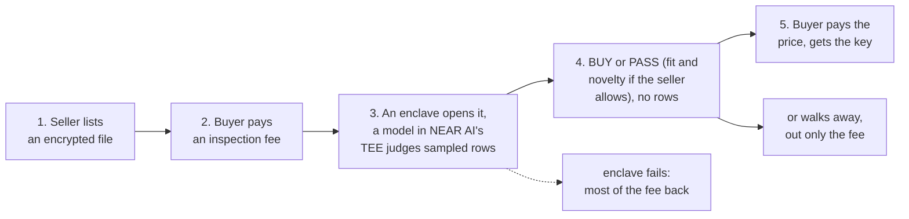
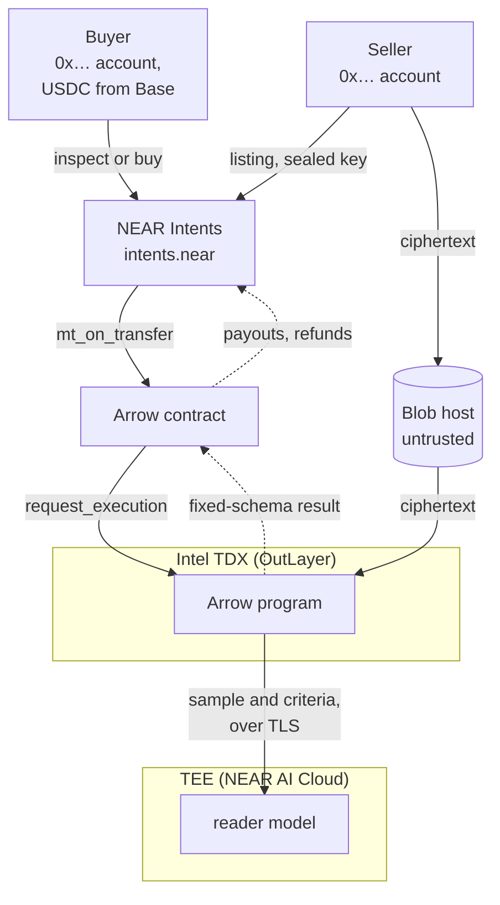
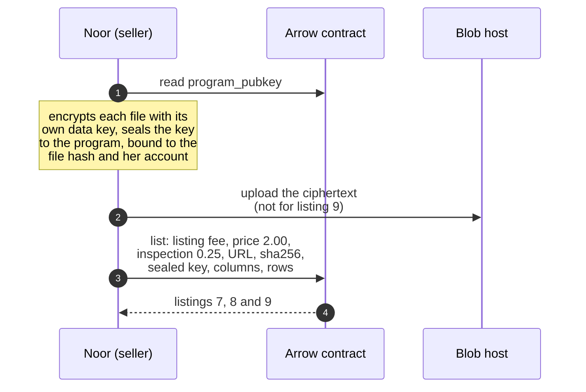
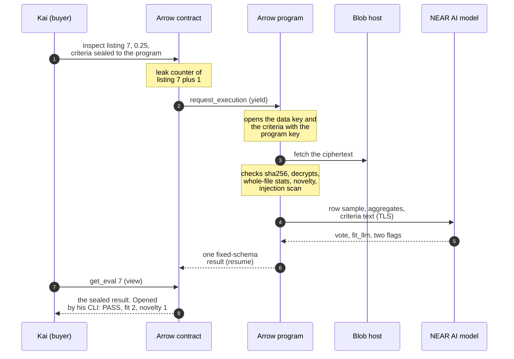
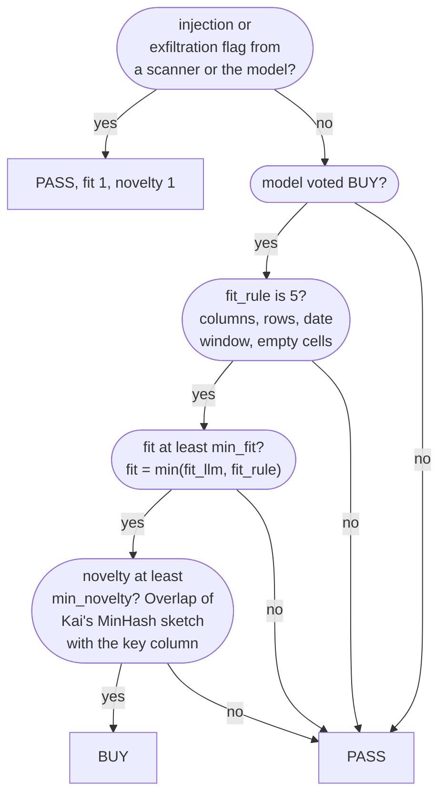
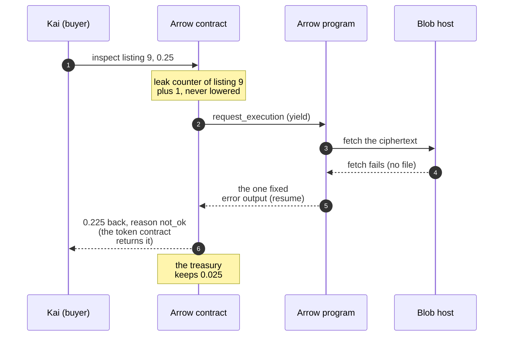
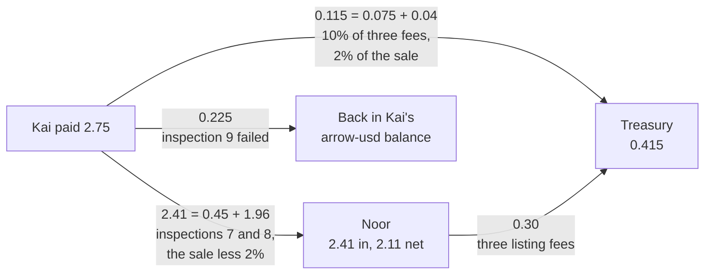
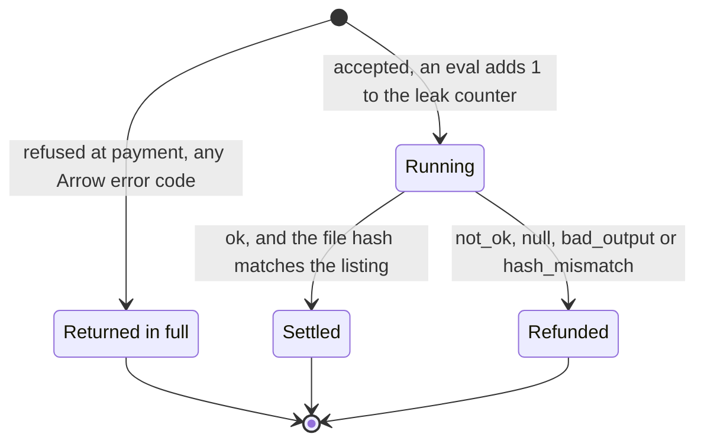

# Arrow: inspect before you pay, on NEAR

You cannot sell information: to judge its value the buyer must see it, and once they have seen it they have no reason to pay ([Kenneth Arrow, 1962](https://www.nber.org/books-and-chapters/rate-and-direction-inventive-activity-economic-and-social-factors/economic-welfare-and-allocation-resources-invention)). Arrow is a data market on NEAR, named after that paradox, where the buyer does not look: for a small fee, [a fixed model](docs/design.md#near-ai-call) in NEAR AI's TEE judges a sample of the seller's rows against the buyer's criteria, and the buyer gets BUY or PASS, plus fit and novelty from 1 to 5 if the seller allows them ([decision](docs/design.md#decision)), not the rows. On mainnet (not deployed yet), payment is USDC from Base through NEAR Intents, and when an inspection fails most of the fee comes back ([amounts](#6-who-got-paid)).



*The story in [How it works](#how-it-works) follows one recorded testnet run; the two names are illustrative, and both accounts are the team's. **Noor**, an on-chain analyst, sells a token unlock schedule and a file of labelled wallets, plus a third listing broken on purpose. **Kai**, research lead at a small fund, already tracks 412 token contracts and 1,000 wallets and will not pay for a file he cannot see. State of the build: [Status](#status).*

**[The story](#how-it-works) · [Try it](#try-it-do-x-see-y) · [Evidence ledger](JUDGES.md) · [Pending mainnet steps](JUDGES.md#pending-ledger) · [Testnet contract](https://testnet.nearblocks.io/address/arrow-v2.arrowhq.testnet) · [Design notes](docs/design.md)**

## Trust table

**PROVEN**: a command or transaction shows it today; the parenthesis says where. **RISKY**: true, and a weakness. **NOT PROVEN**: we do not claim it. **TODO**: waits for a [Pending ledger](JUDGES.md#pending-ledger) step. `J#n` is row n of [JUDGES.md](JUDGES.md). Each row counted under its weakest label: 3 PROVEN, 14 RISKY, 4 NOT PROVEN, 4 TODO.

| Part | Who you trust | Can see | Cannot | How to check | Label |
|---|---|---|---|---|---|
| Seller data at rest | Nobody (ciphertext; the blob host is untrusted) | The blob host: the ciphertext and each downloader's IP and user agent. Anyone: the exact plaintext size, column names, row count and the seller's `0x…` account | Decrypt | [Hash binding](docs/design.md#hash-binding); J#14, J#55; Pending M7a-c. Once deployed, the hosted site keeps web sellers' ciphertext in a Vercel Blob store only while the hosted demo runs (at least until 2026-11-18, planned until 2026-11-25) | TODO (mainnet run) |
| Program key / `PROTECTED_MASTER` | OutLayer keystore (TDX) and the shared OutLayer master | Inside the TEE | Release to a non-Arrow caller or (untested) to an unpinned wasm | `WasmHash` + `Predecessor` access condition; negative tests: J#11, J#45. Before the lock the owner can move the rule that ties the key to the wasm hash, and no verify row checks it | PROVEN (`Predecessor`: testnet echo program, mainnet spike program), NOT PROVEN (`WasmHash`) |
| OutLayer keystore DAO | Can export keys on "cessation" | Potentially everything, including the buyer's sealed criteria, whose MinHash sketch is unkeyed: up to 128 members of the buyer's list can be recovered | n/a | J#40, J#50 | RISKY |
| Evaluation | Intel TDX (OutLayer worker) | Plaintext inside the TEE | Emit anything outside the schema | J#1-3. Attestation binding: [S1-b](JUDGES.md#gates-already-run) (echo program); J#13, J#48 (Arrow program). The TDX quote is not verified on chain (J#38) | PROVEN (schema: native test) |
| LLM | NEAR AI gateway (TDX) and model TEE (TDX + NVIDIA CC) | Each eval's prompt: the sample, whole-file aggregates and the criteria ([NEAR AI call](docs/design.md#near-ai-call)) | Retain data (NEAR AI's zero-data-retention claim is a trust assumption) | J#37, J#49 | NOT PROVEN |
| Wasm to NEAR AI | TLS (not E2EE) | n/a | n/a | [NEAR AI call](docs/design.md#near-ai-call) | RISKY |
| Time guard | The TDX clock, which the host provides | n/a | n/a | [Limits](docs/design.md#timeouts); J#19. A release refused as late still leaves its `k`, sealed to the buyer, public while the buyer keeps the refund | RISKY |
| OutLayer coordinator (closed source) | Liveness | Encrypted input | Read secrets (OutLayer's design, a trust assumption) | J#16 | PROVEN (refund on `null`: sandbox) |
| `outlayer.near`, `intents.near` contracts | Their owners (both are upgradable); Arrow depends on them | n/a | n/a | Code-hash history: J#39 | RISKY |
| Program bytes | Whoever serves the wasm URL | The wasm | Change it unnoticed (hash-pinned) | Served from testnet FastFS today; the mainnet host is set at the freeze (Pending F1) | RISKY |
| Output channel | Schema and rule composition | At most 5.68 bits per eval (scored), 1.59 (verdict-only), on this channel only ([derivation](docs/design.md#leak-bound)) | Free text | J#1-3 | PROVEN |
| Error channel | The enclave: one fixed error output, nothing on stderr | The failure states on chain ([leak bound](docs/design.md#leak-bound)) | Carry data | J#4, J#43 | RISKY (stderr and the fixed output: PROVEN, native harness) |
| Side channels | Not closed | `time_ms` and `instructions` on chain, counted in neither the bound nor the budget. `instructions` follows the work: the dataset size, the content of the sampled rows ([seed](docs/design.md#near-ai-call)), the criteria text, the buyer's `key_column` and `date_column` (so it can reveal a chosen column's non-empty and distinct counts) and, on a failed run, the step where it stopped | n/a | J#35; [measured values](docs/perf.md) | RISKY |
| Leak budget | The contract counter | n/a | n/a | [Rules](docs/design.md#leak-budget); J#15, J#41 | RISKY |
| Decision correctness | Structural gates and the LLM | n/a | Override a failed structural gate | J#5 (gates); J#9, J#53 (semantics) | PROVEN (gates), RISKY (semantics) |
| 1Click and the PoA bridge (Intents Technology) | Short custody during swaps | Swap transactions | n/a | Base USDC (other 1Click origins are untested) arrives as a bridged token (`omft.near`) that 1Click swaps into native NEAR USDC, the only token the market accepts; J#24, J#25 | NOT PROVEN (custody), PROVEN (one inbound) |
| Refund destination | `intents.near` | n/a | n/a | Moving a refund back to Base is a separate 1Click withdrawal; J#17; Pending M12 | PROVEN (mainnet, spike contract); TODO (Arrow contract) |
| NEAR AI API key (inside the OutLayer secret) | Billing | Usage volume | See content | If it runs out, evals fail; J#44 | RISKY |
| Gas tank | The operator (tops it up) and OutLayer's NEAR charge | n/a | n/a | `fund_tank` refills it; J#46; [cost, runway and E10](docs/perf.md#gas-tank) | RISKY |
| Relayer account | Whoever holds the keys of `arrow-relayer.arrowhq.near` (the team) | The intents it relays: signer, `msg`, IP | Spend or move user funds: the relayer holds none | Whoever holds its FullAccess key can drain the relayer's gas or stop `/api/relay`; J#47. The relay's rate limits are per server instance and protect only the relayer's gas: across instances the worst case is about 0.34 NEAR of gas (its balance down to the 0.65 NEAR floor, then the hosted relay pauses) and no user funds; a signed payment still runs once (J#56) | RISKY |
| Arrow operator | Relayer liveness, gas tank | The ciphertext blobs it hosts; the IP, `0x…` address and listing of every payment relayed through `/api/relay`; relay idempotency entries and rate counters | Decrypt the blobs it hosts (the site it serves can: Arrow web app row); take funds or change the contract or wasm hash after the lock | J#21, J#56; Pending M15a | TODO |
| Arrow web app (served JavaScript) | Whoever deploys the site (a modified deploy is not detectable from the page) | Everything the page handles: the file and its key, the criteria and the viewing-key signature, which derives every verdict key of that wallet | n/a | The CSP sets no `script-src`. For sensitive data use the CLI; J#52, J#54 | RISKY |
| Buyer viewing key | The buyer's EOA signature ([derivation](docs/design.md#keys)) | Anyone: buyer and seller `0x…` accounts are their EVM (Base) addresses, and `get_eval` shows which account inspected which listing, when, and what it paid | n/a | Any site that obtains the same signature can derive the key; J#51 | RISKY |
| HTTP 402 wrapper | Nothing | n/a | Move funds | [For agents](#for-agents-cli-mcp-http-402); J#27; Pending M16 | TODO |
| After purchase | The buyer | All data | n/a | J#42 | NOT PROVEN |

**Tracks.** Privacy: the buyer gets the verdict, not the rows (trust rows Output channel, LLM, Buyer viewing key). Agents: MCP tools with spend caps that only the operator sets ([For agents](#for-agents-cli-mcp-http-402)). Security: the LLM cannot produce BUY unless the structural gates pass (trust row Decision correctness; the injection room is [Try it](#try-it-do-x-see-y) step 3).

## Status

As of 2026-11-11 02:10 UTC.

- Testnet: contract `arrow-v2.arrowhq.testnet` runs release candidate rc4 `2d2dc4d0…` ([build](#build-from-source)); end-to-end run: [K2](JUDGES.md#gates-already-run). It is not frozen (the freeze fixes the final enclave build and its hash) and not locked (the lock deletes the contract's access keys); pre-freeze listings: [J#57](JUDGES.md#claims).
- Mainnet: the Arrow contract `arrow-market.near` is not deployed and the Arrow program has not run on mainnet; spike runs: [gates](JUDGES.md#gates-already-run).
- Not yet: a hosted demo (not deployed), the demo video (not recorded) and outside demand (no seller invitation sent; drafts in `docs/outreach/`).
- Repository and CI: private until a human makes it public, so repository links (including the contract's NEP-330 source link) do not resolve yet. CI jobs `ts`, `rust`, `web` and `secrets` are green; `tee` is red ([Build from source](#build-from-source)).

## How it works



*The mainnet design; deployment state: [Status](#status).*

- **TEE:** a trusted execution environment, a processor-isolated machine built so that its host cannot read its memory, and able to prove which code it runs. Arrow uses two: OutLayer's Intel TDX for the Arrow program, and NEAR AI Cloud's for the reader model.
- **OutLayer** holds the program key and returns the program's result to the contract through `request_execution` yield and resume.
- **NEAR Intents:** `intents.near` calls the contract with `mt_on_transfer`, and refunds go back through its `mt_resolve_transfer` ([If something fails](#if-something-fails)). Buyer and seller need no NEAR account; they sign from EVM wallets (trust row Buyer viewing key; [standards](docs/design.md#standards)).

**The run.** Everything below is one recorded run on NEAR testnet, gate [K2](JUDGES.md#gates-already-run) of 2026-11-11 on `arrow-v2.arrowhq.testnet`, with synthetic data ([fixtures/demo](fixtures/demo/README.md)), driven by `scripts/src/e2e-testnet.ts` through the CLI's own commands. Noor is `e2e-seller.arrowhq.testnet` and Kai is `e2e-buyer.arrowhq.testnet`. Testnet has no `intents.near` or 1Click, so the money is the test token `arrow-usd` (aUSD, the testnet stand-in for USDC), sent straight to the contract; every amount below is in aUSD.

### 1. Noor makes three listings (two files, one broken on purpose)

She encrypts each file on her machine with its own data key, uploads only the ciphertext to a host nobody has to trust, and seals the data key to the Arrow program. She pays a listing fee for each ([Money](#6-who-got-paid)) and asks 2.00 for the file and 0.25 for an inspection. Listing 7 is the 412-row unlock schedule, listing 8 the 1,000 wallet labels, and listing 9 the same labels at a host URL that does not exist, on purpose. Transactions: [7](https://testnet.nearblocks.io/txns/3SeSFNERHrLZETz8br1PuXQWZSRhCDDHyzQsVz4XxRfg), [8](https://testnet.nearblocks.io/txns/4QkSp9Qgj7eNL6BSKKeYJJLRi4kjf5DVfTKb5UW5YCdW), [9](https://testnet.nearblocks.io/txns/H8dAVcC6bKWf4QPQC5MeoGALSLGggj857Ddhp8sZ5o5L).



### 2. Kai inspects listing 7: PASS

His criteria (`fixtures/criteria/demo.json`) ask for a "Q1 2027 token unlock schedule with exact dates, amounts and % of supply; I also want audit flags for the vesting contracts", with fit at least 4 and novelty at least 3. They carry a MinHash sketch of the contracts he already tracks, and they are sealed to the program. He pays 0.25. The answer is sealed to his key, and his CLI opens it ([tx](https://testnet.nearblocks.io/txns/LwYzQ9gTWhCHxW36G8aFrx8D3vfzLuAbkeRzb91qsev)):

```text
PASS · fit 2/5 · novelty 1/5
```

He saw no row, and Noor never saw his criteria text.



### 3. Kai inspects listing 8: BUY

His criteria (`fixtures/criteria/demo-buy.json`) ask for labelled NEAR DeFi wallets with confidence scores, active August to October 2026, at least 800 rows and at most 1% empty cells. He pays 0.25 again and gets ([tx](https://testnet.nearblocks.io/txns/3w8N1z7GMYrR8vy5C9Ts5m9sW7FU45JnX4LSZ6qinrVC)):

```text
BUY · fit 5/5 · novelty 4/5
```

Why the two answers differ ([decision](docs/design.md#decision)):



- Listing 7: the file has no `vesting_contract_audit` column, so `fit_rule` is 4. 371 of Kai's 412 contracts are already in it, and a MinHash estimate of that overlap puts novelty at 1, below his 3. That is PASS whatever the model voted. The model scored fit 2.
- Listing 8: every structural gate holds (`fit_rule` 5). Only 300 of Kai's 1,000 wallets are in it, and the estimate puts novelty at 4. The model voted BUY with fit 5.

Rerun the rule half on your machine: [Try it](#try-it-do-x-see-y) step 2.

### 4. Kai buys listing 8

Before paying, his CLI downloads the ciphertext and checks its sha256. He pays 2.00 and sends his public viewing key (purchase 3, [tx](https://testnet.nearblocks.io/txns/5aBwbUbzBeXf9QfwDszuBL1epWK4Z7khZXy9iVaxDQxh)). The enclave fetches the ciphertext again, checks that its sha256 is the listed one and that the data key opens it, and seals the key to Kai's key. Kai decrypts on his machine. Four hashes are equal: the listed hash, the hash the enclave inspected, the hash it released, and the hash of Kai's download. From here the file is his (trust row After purchase).


### 5. Listing 9 fails

Kai pays 0.25 to inspect listing 9. The enclave cannot fetch the file, because its host is missing on purpose, and writes its one fixed error output. The contract settles the inspection as `not_ok`: 0.225 goes back to Kai's `arrow-usd` balance and the treasury keeps 0.025 ([tx](https://testnet.nearblocks.io/txns/DdRirLEMBc54WMLicZHjJ2pEx9aiWrGWGk7ng73otjYc)). The failed inspection still counts on listing 9's leak counter. Other failures: [If something fails](#if-something-fails).



### 6. Who got paid

- **Money.** The seller sets the price (at least 0.10 USDC) and the inspection fee (at least 0.05 USDC, at most the price; `scripts/deploy/init-mainnet.json`). The treasury keeps 10% of each inspection fee and 2% of each sale. A failed purchase is refunded in full, a failed inspection less the treasury's share. Each listing costs a 0.10 USDC fee to the treasury (`listing_bond`), which is not refunded.



Kai's net spend is 2.525: one file he wanted, and an answer that kept 2.00 in his pocket. The run recorded Kai's payments and the listing 9 split; the other splits apply the live fee settings (`get_config`) to the run.

Check it yourself: each transaction above opens on testnet nearblocks; the `get_eval` command is in J#51.

## Try it (do X, see Y)

Node 22.22.2 or later (tested on 24.15.0) and Rust 1.97.1, which `rust-toolchain.toml` pins and rustup installs on the first `cargo` call. No keys, funds, wallet or browser. "(network)" marks a step that needs internet; step 2, the first `cargo` call, also needs it once (rustup and crates.io).

1. `git clone https://github.com/yigitcangokmen/arrow && cd arrow && npm ci` (network).
   - See: `added 832 packages` (on macOS arm64; platform-specific packages vary).
   - `npm ci` runs the install scripts of the locked packages; no audit gate stops it.
2. `cargo test -p arrow-core --test demo_bands` (the first build takes minutes).
   - See: `test result: ok. 4 passed`. It reruns the rule half of [story step 3](#3-kai-inspects-listing-8-buy) (`fit_rule` and novelty) on the demo files.
3. `npm run bench:offline`.
   - See: `| Room: stopped by the deterministic layer alone (room has 24 attacks) | 20/24 (83.3%) |`; every live line reads `not run`.
   - All bench data is synthetic and labelled so; the bench criteria have not been reviewed by a person yet (`bench/REVIEW.md`). The team-made dataset is NEAR public-RPC chain statistics (`fixtures/team-made/SOURCE.md`).
4. `cargo test -p arrow-core`.
   - See: `test result: ok.` for the unit tests and each of the four integration test files.
5. `cargo run -p s4-interop --release`. See: `S4-b ecies ts->rs: 8/8 PASS`, `S4-b xchacha ts->rs: 4/4 PASS`, `S4-b minhash ts->rs: 10/10 PASS`, and a last line that starts `S4-b RESULT: PASS`.
   - Other direction and known gaps: J#32.
6. `npm run arrow -- --help`.
   - See: the commands `list`, `eval`, `result`, `buy`, `rehost`, `status`, `decrypt`, `transfer` and the line `exit codes: 0 ok · 1 error · 2 usage · 3 still pending (use status) · 4 refunded · 5 needs a terminal or --yes · 6 leak budget exhausted`.
7. `bash scripts/check-claims.sh && npm run check:judges -- --readme`.
   - See: nothing from the first command, which scans the judge-facing text for the claims we promise not to make (below), then `JUDGES.md: 57 rows, 0 missing` (every path and test name in the ledger exists).
8. `npx tsx spikes/s3/s3a-simulate.ts` (network: a free mainnet `simulate_intents` view, signed with a throwaway key; nothing is sent).
   - See: `class: SIGNATURE_OK_BALANCE_ERROR` (J#26).

**Steps 9 and 10 stop on purpose until the enclave build is frozen (Pending F1).** Each says what you see today.

9. `npm run verify -- --network testnet` (network, about a minute).
   - See: `[PROVEN]` on I2, I3 and I4, and the last line `verify: 0/5 REQUIRED PROVEN · exit 1`. Why the other rows fail: J#12 (R1), J#13-16 (R2, R3, R5, R8), J#48 (I1).
10. `npm run try:testnet` (network).
    - See today: it stops before any faucet call with `…/fixtures/testnet-listings.json is missing: the team publishes the demo listings with e2e-testnet --publish-demo` (exit 1). Nothing was spent. What it runs after the freeze: J#30.

## If something fails



- **Returned:** the contract refuses inside the transfer call, so the token contract gives back the whole amount.
- **Settled:** the verdict or the data key, sealed to the buyer.
- **Refunded:** with the amounts of [Money](#6-who-got-paid).

| What you see | What happened | Where your money is (testnet: `arrow-usd` in your NEAR account) | Read more |
|---|---|---|---|
| `Node 22.22.2 or newer is needed (found 18.20.8). Run: nvm use` | Node is too old (`try:testnet` and `scripts/check-all.sh` check it) | Nothing was spent | Try it preface |
| Step 8, 9 or 10 ends with a network error | RPC or registry unreachable | Nothing was spent | Try it preface |
| CLI exit 4, `arrow_refund{reason:"not_ok"}` or a `null` result | The enclave failed or timed out | Your NEAR Intents balance, with the amounts of [Money](#6-who-got-paid) | Trust row Refund destination; J#16, J#18; [story step 5](#5-listing-9-fails) |
| `arrow_refund{reason:"hash_mismatch"}` on buy | [Hash binding](docs/design.md#hash-binding) | Your NEAR Intents balance, in full | J#14; [flow 1](docs/flows.md#1-the-file-is-swapped-before-a-purchase-settles) |
| CLI exit 6 | The listing's leak budget is used up; the CLI stops before paying | Nothing was spent | Trust row Leak budget; J#15; [flow 3](docs/flows.md#3-the-leak-budget-is-spent-sales-stay-open) |
| `E10` or `E21` | The gas tank is low (E10), or the listing has too many evals in flight (E21, J#46); the contract refuses the payment | Back in your NEAR Intents balance | Trust row Gas tank |
| `E13` after paying on the CLI or MCP | The listing was sealed to an older program (J#57) | Back in your NEAR Intents balance | [Keys](docs/design.md#keys); [flow 2](docs/flows.md#2-a-listing-sealed-to-an-older-program) |
| CLI exit 3 | The eval or purchase is still running | In flight in the contract | `npm run arrow -- result <id>` or `status` |

## For agents: CLI, MCP, HTTP 402

- **CLI:** `npm run arrow -- <command>`, always through `npm run` (the bare npx package name belongs to an unrelated project). Commands and exit codes: Try it step 6.
- **MCP:** server `arrow` with seven tools: `inspect_before_buy`, `buy`, `get_listing`, `list_listings`, and the free recovery tools `get_eval_result`, `get_purchase`, `decrypt_purchase` (J#28). Client config: [agent/README.md](agent/README.md); it runs the lockfile's tsx. Purchases are written at mode 0600 under `ARROW_MCP_OUT_DIR` (default `~/.config/arrow/purchases`). What an agent cannot do without its operator is in the diagram below.
- **HTTP 402:** `/api/x402/<id>` (a listing id) answers 402 with `accepts` empty on purpose; paying goes through NEAR Intents (`mt_on_transfer`), with no facilitator (J#27).


The variables, all prefixed `ARROW_MCP_`: `ALLOW_MAINNET` and `ALLOW_BUY` are off unless set to 1; `MAX_USDC` caps each payment (default 1.00) and `MAX_USDC_TOTAL` the session (default 5.00). Only the operator sets these variables; a tool argument is not consent. With the defaults, Kai's agent could inspect listing 8 (0.25) but not buy it (2.00) until his operator allowed buying and raised the cap.

## Differences from prior work

| Project | Source | What it does | What Arrow adds |
|---|---|---|---|
| TrustKit / NDAI | [github.com/discordwell/ndai-hackathon](https://github.com/discordwell/ndai-hackathon) · [arXiv 2502.07924](https://arxiv.org/abs/2502.07924) | Two agents negotiate inside an enclave; README: "egress whitelist of the LLM API hosts"; output fields "outcome, price, reason"; escrow on Base/Ethereum Sepolia | The reader model itself runs in a TEE (NEAR AI Cloud); the buyer gets a capped verdict (Output channel row), not free text; refunds by `intents.near` |
| Information Bazaar | [arXiv 2403.14443](https://arxiv.org/abs/2403.14443) · [github.com/tn-learn/info-bazaar](https://github.com/tn-learn/info-bazaar) | Open-source simulated market; LLM agents inspect and then forget | Not a simulation: a recorded run on NEAR testnet ([K2](JUDGES.md#gates-already-run)) |
| DeadDrop | [github.com/Hothit1/deaddrop](https://github.com/Hothit1/deaddrop) | Encrypted file sale, escrowed key delivery by a keeper, testnet | DeadDrop guarantees delivery; Arrow lets the buyer judge value before paying |
| Ocean Compute-to-Data | [github.com/oceanprotocol/docs](https://github.com/oceanprotocol/docs) (compute-to-data) | Provider checks datatokens before the job; "results and logs" are returned to the consumer; the consumer writes the algorithm | Inspection before payment, bounded output, natural-language criteria, TEE |
| Sealed Exploit · AgentEscrow · SealedBounty | [@edycutjong on X](https://x.com/edycutjong/status/2117725204403364028) · [@dele_dave on X](https://x.com/dele_dave/status/2117911300516823327) · [@0xJoydeeeep on X](https://x.com/0xJoydeeeep/status/2119815388657774668) | A TEE verdict releases escrow | The condition is the buyer's private criterion over the seller's private data, judged before the buyer pays for the data |
| x402 / Penstock | [github.com/coinbase/x402](https://github.com/coinbase/x402) (spec v2) · [github.com/ace-coderr/penstock](https://github.com/ace-coderr/penstock) | Pay-first paywalls for HTTP and MCP | Complementary ([For agents](#for-agents-cli-mcp-http-402)) |
| Spend firewalls (uprali, Warden, Clear to Pay) | [github.com/aly-coding/uprali-mvp](https://github.com/aly-coding/uprali-mvp) · [@saxxyweb3 on X](https://x.com/saxxyweb3/status/2119774924499800353) · [@joezzyweb3 on X](https://x.com/joezzyweb3/status/2119220897345122339) | Control whom and how much an agent pays | Arrow checks what is being bought |
| Charter · cipherwork | [github.com/Spagero763/charter](https://github.com/Spagero763/charter) · [github.com/wadadawadada/cipherwork](https://github.com/wadadawadada/cipherwork) | Same stack family (NEAR AI, OutLayer, Intents), privacy for one party | Before a purchase the seller does not see the criteria text and the buyer does not see the rows; limits: Side channels and Buyer viewing key rows |

## What we do not claim

<!-- claims:quoted:start -->
- Not zero-knowledge.
- No NEAR MPC CKD.
- Not "nothing leaks".
- Not "no bridge".
- Not "first NDAI".
- The keyless contract plus OutLayer pattern also appears in other hackathon entries. We do not present it as novel.
<!-- claims:quoted:end -->

## Build from source

**Enclave.** `bash scripts/build-tee.sh target/rel-tee` prints the sha256 of `arrow-tee.wasm`; flags and toolchain are in [release/BUILD.md](release/BUILD.md). The two build hosts measured so far give different shas from the same source; other hosts are untested:

| Build host | sha256 of `arrow-tee.wasm` (rc4) |
|---|---|
| macOS arm64 (`aarch64-apple-darwin`, rustc 1.97.1) | `2d2dc4d0c6aff708105f208d8afd9b71081cea9a7fe400a4b7eec2927ef38ee1` (1 696 881 bytes; `release/arrow-tee-rc.sha256`) |
| Linux x86_64 (GitHub `ubuntu-24.04`, rustc 1.97.1, CI run 42934861136, job `tee`) | `6ad7fed42691279cbcb43c3e8599fa0ef70ed7c54669e954b5acb31c03e1abc1` |

Suspected cause, not confirmed: crates with a build script get a host-dependent crate disambiguator. The team picks the canonical build host before the freeze (Pending F1).

**Contracts.** `cargo near build reproducible-wasm`, then compare with the code hash of `arrow-market.near` once it is deployed (Pending M2). The committed `release/contracts/arrow-mainnet.wasm` predates the fixes, and `bash scripts/deploy/mainnet-check.sh wasm` prints `FAIL contract_wasm_stale` until it is rebuilt.

## Hackathon rules

- **Code window:** no pre-hackathon code. The first commit is `8ae64ef` (2026-11-10 14:57 +0700), inside the window that opened on 2026-10-19; check with `git log --reverse --format='%h %ad' | head -1`.
- **Existing product on another chain:** none.
- **Templates and libraries:** templates `out-layer/private-dao-example` and `out-layer/ai-example`. Libraries behind a claim: `@phala/dcap-qvl` 0.7.1 (DCAP on `/verify`), `@modelcontextprotocol/sdk` 1.32.2, Next.js 16.4.6. Everything else is pinned in `package-lock.json` and `Cargo.lock`.
- **AI code:** Parts of the code were written with AI coding assistants and reviewed by the team.
- **Keys in this repository:** none, except the demo buyer's viewing key, derived in code from the public label `arrow:demo-buyer:public:v1`. It holds no funds and decrypts only demo purchases (`sdk/src/viewingKey.ts`).
- **Other projects:** [Tender](https://github.com/kocality/tender) is another project by team members, independent: no shared code, contracts, accounts or wallets.
- **License:** MIT (`LICENSE`).

## Repo layout

`contracts/` (arrow, arrow-usd, mock-outlayer) · `enclave/` (arrow-core, arrow-tee) · `sdk/` · `web/` (pages `/sell`, `/buy/[id]`, `/seller`, `/verify`, `/attack`, `/try`) · `agent/` · `scripts/` · `bench/` · `fixtures/` · `spikes/` · `release/` · `docs/`
