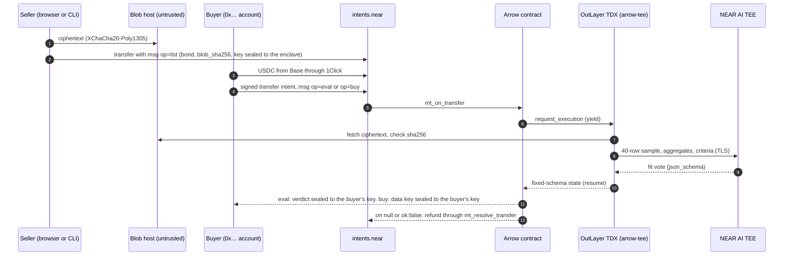

# Arrow: inspect before you pay, on NEAR

Arrow is a data market on NEAR where a buyer learns whether a dataset fits before paying for it, without seeing its rows. The seller encrypts the file in the browser and seals its key to an enclave. The buyer pays an inspection fee in USDC from Base through NEAR Intents and gets back BUY or PASS; in scored mode, which the seller picks, also a fit score and a novelty score from 1 to 5, novelty being measured against a key list the buyer may send. A purchase releases the data key, sealed to the buyer's key. If the enclave fails or times out, `intents.near`'s own `mt_resolve_transfer` refunds the buyer's NEAR Intents balance: a purchase in full, an inspection less the treasury's 10% share of its fee.

You cannot sell information: to judge its value the buyer must see it, and once they have seen it they have no reason to pay (Kenneth Arrow, 1962, [NBER](https://www.nber.org/books-and-chapters/rate-and-direction-inventive-activity-economic-and-social-factors/economic-welfare-and-allocation-resources-invention)). In Arrow the buyer does not look: a fixed model (`Qwen/Qwen3.8-27B`) in NEAR AI's TEE (trusted execution environment: a processor-isolated machine built so that its host cannot read its memory, and able to prove which code it runs) judges a fresh 40-row sample against the buyer's criteria, and the buyer gets the verdict, not the rows. The sample travels from Arrow's enclave to NEAR AI over TLS.

**What NEAR does here.** NEAR AI Cloud runs the reader model (private inference). OutLayer runs the Arrow program in Intel TDX, holds the program key and returns the verdict through `request_execution` yield and resume. NEAR Intents carries the money: `intents.near` calls the market contract with `mt_on_transfer`, and buyer and seller need no NEAR account (`0x…` implicit accounts).

**[Try it](#try-it-do-x-see-y) · [Example run](#how-it-works) · [Evidence ledger](JUDGES.md) · [Pending mainnet steps](JUDGES.md#pending-ledger) · [Testnet contract](https://testnet.nearblocks.io/address/arrow-v2.arrowhq.testnet) · [Design notes](docs/design.md)**

## Status (as of 2026-11-11 02:10 UTC)

- Testnet: contract `arrow-v2.arrowhq.testnet` runs release candidate rc4 `2d2dc4d0…` (the macOS arm64 build, see [Build from source](#build-from-source)) from testnet FastFS, with test token `arrow-usd.arrowhq.testnet`; the end-to-end run is green, 9 of 9 steps ([K2](JUDGES.md#gates-already-run)). It is not frozen (the freeze fixes the final enclave build and its hash) and not locked (the lock deletes the contract's access keys); listings made now stop being readable if the freeze changes the program key ([keys](docs/design.md#keys)).
- Mainnet: the Arrow contract `arrow-market.near` is not deployed and the Arrow program has not run on mainnet; each step still to come is a row of the [Pending ledger](JUDGES.md#pending-ledger). Payment, refund and enclave composition ran on mainnet with a spike contract and a spike program ([gates](JUDGES.md#gates-already-run)).
- Not yet: a hosted demo (not deployed), the demo video (not recorded) and outside demand (no seller invitation sent; drafts in `docs/outreach/`).
- Repository and CI: private until a human makes it public, so repository links (including the contract's NEP-330 source link) do not resolve yet. CI jobs `ts`, `rust`, `web` and `secrets` are green; `tee` is red ([Build from source](#build-from-source)).

## Trust table

**PROVEN**: a command or transaction shows it today; the parenthesis says where. **RISKY**: true, and a weakness. **NOT PROVEN**: we do not claim it. **TODO**: waits for a [Pending ledger](JUDGES.md#pending-ledger) step. `J#n` is row n of [JUDGES.md](JUDGES.md).

| Part | Who you trust | Can see | Cannot | How to check | Label |
|---|---|---|---|---|---|
| Seller data at rest | Nobody (ciphertext; the blob host is untrusted) | The blob host: the ciphertext and each downloader's IP and user agent. Anyone: the exact plaintext size, column names, row count and the seller's `0x…` account | Decrypt | `blob_sha256` is on chain and the enclave checks it before reading. Once deployed, the hosted site keeps web sellers' ciphertext in a Vercel Blob store only while the hosted demo runs (at least until 2026-11-18, planned until 2026-11-25; [web/README.md](web/README.md)); `op=rehost` (CLI only) moves a listing; J#14, J#55; Pending M7a-c | TODO (mainnet run) |
| Program key / `PROTECTED_MASTER` | OutLayer keystore (TDX) and the shared OutLayer master | Inside the TEE | Release to a non-Arrow caller (tested); release to an unpinned wasm (configured, not tested) | `WasmHash` + `Predecessor` access condition; the negative tests check the `Predecessor` condition only (J#11, J#45). Before the lock the owner can move the rule that ties the key to the wasm hash, and no verify row checks it | PROVEN (`Predecessor`: testnet echo program, mainnet spike program), NOT PROVEN (`WasmHash`: configured, no negative test) |
| OutLayer keystore DAO | Can export keys on "cessation" | Potentially everything, including the buyer's sealed criteria, whose MinHash sketch is unkeyed: up to 128 members of the buyer's list can be recovered | n/a | J#40, J#50 | RISKY |
| Evaluation | Intel TDX (OutLayer worker) | Plaintext inside the TEE | Emit anything outside the schema | Native tests J#1-3. The attestation ties a run to its wasm and I/O for the echo program ([S1-b](JUDGES.md#gates-already-run)); for the Arrow program that check is not proven yet (J#13, J#48) | PROVEN (schema: native test) |
| LLM | NEAR AI gateway (TDX) and model TEE (TDX + NVIDIA CC) | Each eval's sample ([NEAR AI call](docs/design.md#near-ai-call)), whole-file aggregates (row count, null %, duplicate %, date range) and the criteria. The sample is drawn afresh for every eval, so over a listing's evals NEAR AI sees up to 40 more rows each time, which can add up to most or all of a file | Retain data (NEAR AI's zero-data-retention claim is a trust assumption) | J#37, J#49 | NOT PROVEN |
| Wasm to NEAR AI | TLS (not E2EE) | n/a | n/a | Endpoint and model are fixed in source ([NEAR AI call](docs/design.md#near-ai-call)) | RISKY |
| Time guard | The TDX clock, which the host provides | n/a | n/a | By that clock the enclave refuses a late result ([limits](docs/design.md#timeouts)). A release published after the yield window is refused, but its `k` (sealed to the buyer) is public while the buyer keeps the refund; J#19 | RISKY |
| OutLayer coordinator (closed source) | Liveness | Encrypted input | Read secrets (OutLayer's design, a trust assumption) | If it fails, the callback gets `null` and the buyer is refunded; J#16 | PROVEN (refund on `null`: sandbox) |
| `outlayer.near`, `intents.near` contracts | Their owners (both are upgradable); Arrow depends on them | n/a | n/a | Code-hash history: J#39 | RISKY |
| Program bytes | Whoever serves the wasm URL | The wasm | Change it unnoticed (hash-pinned) | Served from testnet FastFS today; the mainnet host is set at the freeze (Pending F1) | RISKY |
| Output channel | Schema and rule composition | At most 5.68 bits per eval (scored), 1.59 (verdict-only), counting the one error output, on this channel only; `null` is the Error channel row ([derivation](docs/design.md#leak-bound)) | Free text | `cargo test -p arrow-core output_space`; J#1-3 | PROVEN |
| Error channel | The enclave: one fixed error output, nothing on stderr | At least two failure states on chain, `ok:false` (refund reason `not_ok`) and `null` ([leak bound](docs/design.md#leak-bound)) | Carry data | `bash scripts/dev/stderr-harness.sh`; J#4, J#43 | RISKY (stderr and the fixed output: PROVEN, native harness) |
| Side channels | Not closed | `time_ms` and `instructions` on chain, counted in neither the bound nor the budget. `instructions` follows the work: the dataset size, the content of the sampled rows (each eval's seed is public), the criteria text, the buyer's `key_column` and `date_column` (so it can reveal a chosen column's non-empty and distinct counts) and, on a failed run, the step where it stopped | n/a | J#35; [measured values](docs/perf.md) | RISKY |
| Leak budget | The contract counter | n/a | n/a | A buyer can burn it with forced failures, each costing them 10% of the fee ([rules](docs/design.md#leak-budget)); J#15, J#41 | RISKY |
| Decision correctness | Structural gates and the LLM | n/a | The LLM cannot produce BUY unless the structural gates pass | `cargo test -p arrow-core llm_cannot_buy` (J#5). Semantic injection on valid data can still sway the LLM (J#9), and a seller who hosts the blob can choose which samples get scored (J#53) | PROVEN (gates), RISKY (semantics) |
| 1Click and the PoA bridge (Intents Technology) | Short custody during swaps | Swap transactions | n/a | Base USDC (other 1Click origins are untested) arrives as a bridged token (`omft.near`) that 1Click swaps into native NEAR USDC, the only token the market accepts. One paid inbound ran (J#24); the Solana withdrawal is Pending M13 | NOT PROVEN (custody), PROVEN (one inbound) |
| Refund destination | `intents.near` | n/a | n/a | Refunds land in the buyer's NEAR Intents balance; moving them back to Base is a separate 1Click withdrawal; J#17; Pending M12 | PROVEN (mainnet, spike contract); TODO (Arrow contract) |
| NEAR AI API key (inside the OutLayer secret) | Billing | Usage volume | See content | The mainnet inference key is the NEAR Builders hackathon key. It cannot be topped up and its expiry is not published; if it runs out, evals fail and are refunded less 10% of their fee; J#44 | RISKY |
| Gas tank | The operator (tops it up) and OutLayer's NEAR charge | n/a | n/a | Forced failures run it down ([cost, runway and E10](docs/perf.md#gas-tank)); `fund_tank` refills it; J#46 | RISKY |
| Relayer account | Whoever holds the keys of `arrow-relayer.arrowhq.near` (the team) | The intents it relays: signer, `msg`, IP | Spend or move user funds: the relayer holds none | The server's key is a function-call key limited to `intents.near` `execute_intents`. The account also holds a FullAccess key, whose holder can drain the relayer's gas or stop `/api/relay`; the market lock does not cover it; J#47 | RISKY |
| Arrow operator | Relayer liveness, gas tank | The ciphertext blobs it hosts; the IP, `0x…` address and listing of every payment relayed through `/api/relay`; relay idempotency entries and rate counters, kept in memory per serverless instance (so the limits do not hold across instances) | Decrypt the blobs it hosts (the site it serves can: Arrow web app row); take funds or change the contract or wasm hash after the lock | J#21, J#56; Pending M15a | TODO |
| Arrow web app (served JavaScript) | Whoever deploys the site (a modified deploy is not detectable from the page) | Everything the page handles: the file and its key, the criteria and the viewing-key signature, which derives every verdict key of that wallet | n/a | No script policy is set. The web buyer pays before downloading the ciphertext, while the CLI and MCP check its hash first. For sensitive data use the CLI; J#52, J#54 | RISKY |
| Buyer viewing key | The buyer's EOA signature ([derivation](docs/design.md#keys)) | Anyone: buyer and seller `0x…` accounts are their EVM (Base) addresses, and `get_eval` shows which account inspected which listing, when, and what it paid | n/a | Any site that obtains the same signature can derive the key; J#51 | RISKY |
| HTTP 402 wrapper | Nothing: it carries no payment | n/a | Move funds | [For agents](#for-agents-cli-mcp-http-402); J#27; Pending M16 | TODO |
| After purchase | The buyer | All data | n/a | Resale is not prevented; J#42 | NOT PROVEN |

## Try it (do X, see Y)

Node 22.22.2 or later (tested on 24.15.0) and Rust 1.97.1, which `rust-toolchain.toml` pins and rustup installs on the first `cargo` call. No keys, funds, wallet or browser. "(network)" marks a step that needs internet; steps 4 and 5 also need it once, on the first build (rustup and crates.io).

1. `git clone https://github.com/yigitcangokmen/arrow && cd arrow && npm ci` (network; 27 s in our run, with a warm npm cache).
   - See: `added 832 packages` (on macOS arm64; platform-specific packages vary), then npm's audit summary (today `56 vulnerabilities (18 low, 10 moderate, 28 high)`).
   - `npm ci` runs the install scripts of the locked packages; no audit gate stops it.
2. `bash scripts/check-claims.sh`.
   - See: no output, exit 0. It scans the judge-facing text for the claims we promise not to make (below).
3. `npm run bench:offline`.
   - See: `| Room: stopped by the deterministic layer alone (room has 24 attacks) | 19/24 (79.2%) |`; every live line reads `not run`. The room line is a result recorded at commit `7220e24`; J#7 runs today's scanner.
   - All bench data is synthetic and labelled so; the bench criteria have not been reviewed by a person yet (`bench/REVIEW.md`). The team-made dataset is NEAR public-RPC chain statistics (`fixtures/team-made/SOURCE.md`).
4. `cargo test -p arrow-core` (the first build takes minutes).
   - See: `test result: ok.` for the unit tests and each of the four integration test files.
5. `cargo run -p s4-interop --release`. See: `S4-b ecies ts->rs: 8/8 PASS`, `S4-b xchacha ts->rs: 4/4 PASS`, `S4-b minhash ts->rs: 10/10 PASS`, and a last line that starts `S4-b RESULT: PASS`.
   - TypeScript and Rust agree on the shared vectors; the other direction and the known gaps are in J#32.
6. `npm run arrow -- --help`.
   - See: the commands `list`, `eval`, `result`, `buy`, `rehost`, `status`, `decrypt`, `transfer` and the line `exit codes: 0 ok · 1 error · 2 usage · 3 still pending (use status) · 4 refunded · 5 needs a terminal or --yes · 6 leak budget exhausted`.
7. `npm run check:judges -- --readme`.
   - See: `JUDGES.md: 57 rows, 0 missing` (every path and test name in the ledger exists).
8. `npx tsx spikes/s3/s3a-simulate.ts` (network: a free mainnet `simulate_intents` view, signed with a throwaway key; nothing is sent).
   - See: `class: SIGNATURE_OK_BALANCE_ERROR`: `intents.near` accepts a signed transfer intent with a `msg`, and only the empty balance fails (J#26).
9. `npm run verify -- --network testnet` (network, about a minute).
   - See: `[PROVEN]` on I2, I3 and I4, and the last line `verify: 0/5 REQUIRED PROVEN · exit 1`. The required rows fail for two reasons: R1 waits for the freeze, and R2, R3, R5 and R8 read `evidence/testnet.json`, which still holds the first contract's runs (J#12-16, J#48).
10. `npm run try:testnet` (network).
    - See today: it stops before any faucet call with `…/fixtures/testnet-listings.json is missing: the team publishes the demo listings with e2e-testnet --publish-demo` (exit 1). Nothing was spent. The file is written at the freeze (Pending F1); J#30 says what the step runs afterwards.

Mainnet commands (`npm run verify -- --network mainnet`, `--decrypt-demo`, `npm run replay`, the hosted `/api/x402/<id>` curl) are rows of the [Pending ledger](JUDGES.md#pending-ledger), each with the command that reads it.

## If something fails

| What you see | What happened | Where your money is | Read more |
|---|---|---|---|
| `Node 22.22.2 or newer is needed (found 18.20.8). Run: nvm use` | Node is too old (`try:testnet` and `scripts/check-all.sh` check it) | Nothing was spent | Try it preface |
| Step 8, 9 or 10 ends with a network error | RPC or registry unreachable | Nothing was spent | Steps 2, 3, 6 and 7 run offline |
| CLI exit 4, `arrow_refund{reason:"not_ok"}` or a `null` result | The enclave failed or timed out; the refund is not instant | Your NEAR Intents balance, with the amounts of the first paragraph | Trust row Refund destination; J#16, J#18 |
| `arrow_refund{reason:"hash_mismatch"}` on buy | The hosted file no longer matches `blob_sha256`; the key stays inside | Your NEAR Intents balance, in full | J#14 |
| CLI exit 6 | The listing's leak budget is used up; the CLI stops before paying | Nothing was spent | Trust row Leak budget; J#15 |
| `E10` or `E21` | The gas tank is low (E10), or the listing has too many evals in flight (E21, J#46); the contract refuses the payment | Back in your NEAR Intents balance | Trust row Gas tank |
| `E13` after paying on the CLI or MCP | The listing was sealed to an older program | Back in your NEAR Intents balance | J#57 |
| CLI exit 3 | Still pending | In flight in the contract | `npm run arrow -- result <id>` or `status` |

## How it works

- **Money.** The seller sets the price (at least 0.10 USDC) and the inspection fee (at least 0.05 USDC, at most the price; `scripts/deploy/init-mainnet.json`). The seller keeps 90% of inspection fees and 98% of sales. Each listing costs a 0.10 USDC fee to the treasury (`listing_bond`), which is not refunded.
- **Example from the rc4 testnet run** (synthetic data). The criteria `fixtures/criteria/demo.json` ("Q1 2027 token unlock schedule with exact dates, amounts and % of supply; …") on the 412-row unlock-schedule listing give `PASS · fit 2/5 · novelty 1/5` ([eval tx](https://testnet.nearblocks.io/txns/LwYzQ9gTWhCHxW36G8aFrx8D3vfzLuAbkeRzb91qsev)). The criteria `fixtures/criteria/demo-buy.json` (labelled NEAR DeFi wallets with confidence scores) on the 1 000-row wallet-labels listing give `BUY · fit 5/5 · novelty 4/5` ([eval tx](https://testnet.nearblocks.io/txns/3w8N1z7GMYrR8vy5C9Ts5m9sW7FU45JnX4LSZ6qinrVC)); the purchase ([tx](https://testnet.nearblocks.io/txns/5aBwbUbzBeXf9QfwDszuBL1epWK4Z7khZXy9iVaxDQxh)) releases the key and the decrypted file hashes to the listed hash ([K2](JUDGES.md#gates-already-run)).
- **Tracks.** Privacy: trust rows Output channel, LLM and Buyer viewing key. Agents: [For agents](#for-agents-cli-mcp-http-402). Security-track pieces: trust rows Output channel and Decision correctness, Try it step 3, attestation checks on `/verify`, and the Relayer account row (its FullAccess key).

## For agents: CLI, MCP, HTTP 402

- **CLI:** `npm run arrow -- <command>`, always through `npm run` (the bare npx package name belongs to an unrelated project). Commands and exit codes: Try it step 6.
- **MCP:** server `arrow` with seven tools: `inspect_before_buy`, `buy`, `get_listing`, `list_listings`, and the free recovery tools `get_eval_result`, `get_purchase`, `decrypt_purchase` (J#28). Client config: [agent/README.md](agent/README.md); it runs the lockfile's tsx. Purchases are written at mode 0600 under `ARROW_MCP_OUT_DIR` (default `~/.config/arrow/purchases`). What an agent cannot do without its operator:
  - leave testnet: mainnet needs `ARROW_MCP_ALLOW_MAINNET=1`;
  - buy: `buy` and `decrypt_purchase` need `ARROW_MCP_ALLOW_BUY=1` (a tool argument is not consent);
  - overspend: each payment is capped by `ARROW_MCP_MAX_USDC` (default 1.00) and the session by `ARROW_MCP_MAX_USDC_TOTAL` (default 5.00);
  - pay on mainnet from the CLI without a terminal prompt or `--yes`.
- **HTTP 402:** `/api/x402/<id>` (a listing id) answers 402 with `accepts` empty on purpose; paying goes through NEAR Intents (`mt_on_transfer`), with no facilitator (J#27).

## Differences from prior work

| Project | Source | What it does | What Arrow adds |
|---|---|---|---|
| TrustKit / NDAI | github.com/discordwell/ndai-hackathon · arXiv 2502.07924 | Two agents negotiate inside an enclave; README: "egress whitelist of the LLM API hosts"; output fields "outcome, price, reason"; escrow on Base/Ethereum Sepolia | The reader model itself runs in a TEE (NEAR AI Cloud); the output is a fixed schema bounded in bits (output channel only); refunds by `intents.near` |
| Information Bazaar | arXiv 2403.14443 · github.com/tn-learn/info-bazaar | Open-source simulated market; LLM agents inspect and then forget | Not a simulation: the reader model runs in a TEE, the buyer gets only a capped verdict, and payments go through `intents.near` |
| DeadDrop | github.com/Hothit1/deaddrop | Encrypted file sale, escrowed key delivery by a keeper, testnet | DeadDrop guarantees delivery; Arrow lets the buyer judge value before paying |
| Ocean Compute-to-Data | github.com/oceanprotocol/docs (compute-to-data) | Provider checks datatokens before the job; "results and logs" are returned to the consumer; the consumer writes the algorithm | Inspection before payment, bounded output, natural-language criteria, TEE |
| Sealed Exploit · AgentEscrow · SealedBounty | x.com/edycutjong/status/2117725204403364028 · x.com/dele_dave/status/2117911300516823327 · x.com/0xJoydeeeep/status/2119815388657774668 | A TEE verdict releases escrow | The condition is the buyer's private criterion over the seller's private data, and a buyer who does not buy gets a capped verdict (Output channel row) |
| x402 / Penstock | github.com/coinbase/x402 (spec v2) · github.com/ace-coderr/penstock | Pay-first paywalls for HTTP and MCP | Complementary ([For agents](#for-agents-cli-mcp-http-402)) |
| Spend firewalls (uprali, Warden, Clear to Pay) | github.com/aly-coding/uprali-mvp · x.com/saxxyweb3/status/2119774924499800353 · x.com/joezzyweb3/status/2119220897345122339 | Control whom and how much an agent pays | Arrow checks what is being bought |
| Charter · cipherwork | github.com/Spagero763/charter · github.com/wadadawadada/cipherwork | Same stack family (NEAR AI, OutLayer, Intents), privacy for one party | Before a purchase the buyer gets only the capped verdict (Output channel row) and the seller does not see the criteria text; the public instruction count, which the buyer's column choice moves, leaks around both (Side channels row); identities are public (Buyer viewing key row) |

## What we do not claim

<!-- claims:quoted:start -->
- No on-chain TDX quote verification (J#38).
- Not zero-knowledge.
- No NEAR MPC CKD.
- Not "nothing leaks".
- Not "no bridge".
- Not "first NDAI" (TrustKit/NDAI is prior work).
- The keyless contract plus OutLayer pattern also appears in other hackathon entries. We do not present it as novel.
<!-- claims:quoted:end -->

## Build from source

**Enclave.** `bash scripts/build-tee.sh target/rel-tee` prints the sha256 of `arrow-tee.wasm`; flags and toolchain are in [release/BUILD.md](release/BUILD.md). The two build hosts measured so far give different shas from the same source; other hosts are untested:

| Build host | sha256 of `arrow-tee.wasm` (rc4) |
|---|---|
| macOS arm64 (`aarch64-apple-darwin`, rustc 1.97.1) | `2d2dc4d0c6aff708105f208d8afd9b71081cea9a7fe400a4b7eec2927ef38ee1` (1 696 881 bytes; the bytes on testnet; `release/arrow-tee-rc.sha256`) |
| Linux x86_64 (GitHub `ubuntu-24.04`, rustc 1.97.1, CI run 42934861136, job `tee`) | `6ad7fed42691279cbcb43c3e8599fa0ef70ed7c54669e954b5acb31c03e1abc1` |

This is why CI `tee` is red. Suspected cause, not confirmed: crates with a build script get a host-dependent crate disambiguator. The team picks the canonical build host before the freeze, and the freeze writes `release/sha256.txt`.

**Contracts.** `cargo near build reproducible-wasm`, then compare with the on-chain code hash. Pending: the committed `release/contracts/arrow-mainnet.wasm` predates the fixes, and `bash scripts/deploy/mainnet-check.sh wasm` prints `FAIL contract_wasm_stale` until it is rebuilt (Pending M2).

## Hackathon rules

- **Code window:** no pre-hackathon code. The first commit is `8ae64ef` (2026-11-10 14:57 +0700), inside the window that opened on 2026-10-19; check with `git log --reverse --format='%h %ad' | head -1`.
- **Existing product on another chain:** none.
- **Templates and libraries:** templates `out-layer/private-dao-example` and `out-layer/ai-example`. Libraries behind a claim: `@phala/dcap-qvl` 0.7.1 (DCAP on `/verify`), `@modelcontextprotocol/sdk` 1.32.2, Next.js 16.4.6. Everything else is pinned in `package-lock.json` and `Cargo.lock`.
- **AI code:** Parts of the code were written with AI coding assistants and reviewed by the team.
- **Keys in this repository:** none, except the demo buyer's viewing key, derived in code from the public label `arrow:demo-buyer:public:v1`. It holds no funds and decrypts only demo purchases (`sdk/src/viewingKey.ts`).
- **Other projects:** [Tender](https://github.com/kocality/tender) is another project by team members, independent: no shared code, contracts, accounts or wallets.
- **License:** MIT (`LICENSE`).

## Repo layout

`contracts/` (arrow, arrow-usd, mock-outlayer) · `enclave/` (arrow-core, arrow-tee) · `sdk/` · `web/` (pages `/sell`, `/buy/[id]`, `/seller`, `/verify`, `/attack`, `/try`) · `agent/` · `scripts/` · `bench/` · `fixtures/` · `spikes/` · `release/` · `docs/`
