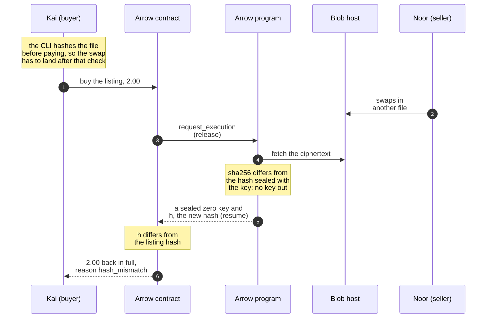
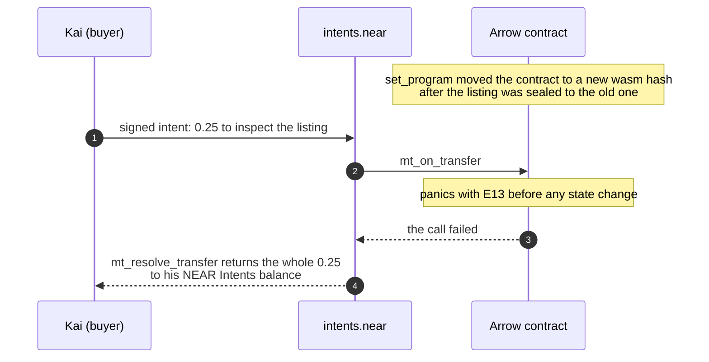
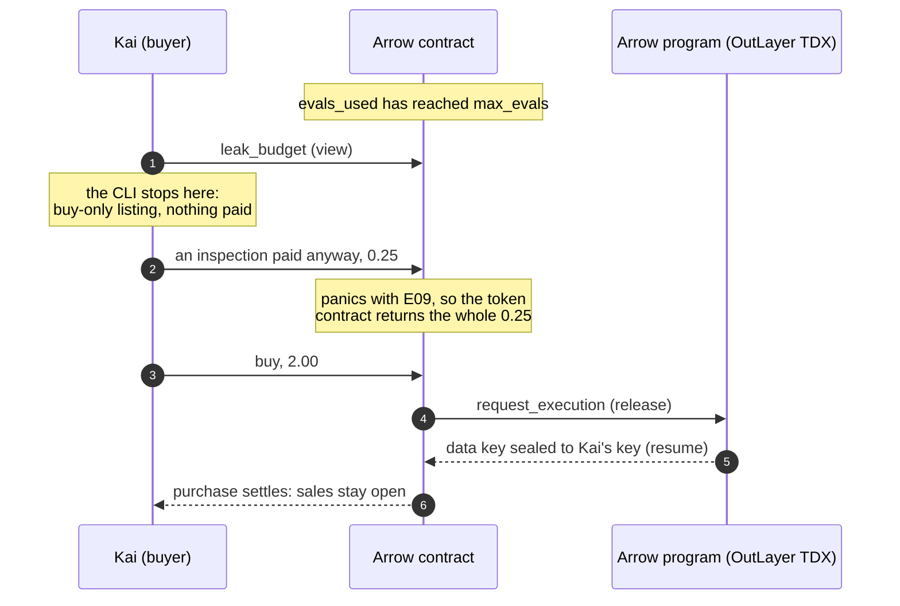

# Arrow: what-if flows

Three failure paths, drawn with Noor and Kai from the [README story](../README.md#how-it-works). None of them is part of the recorded mainnet run; an enclave failure is, as [story step 5](../README.md#5-listing-3-fails). Each one names the [JUDGES](../JUDGES.md#claims) row that checks it; the row holds its label. What you see on your side, and where your money is, is in the README [failure table](../README.md#if-something-fails).

## 1. The file is swapped before a purchase settles

J#14; [hash binding](design.md#hash-binding).

## 2. A listing sealed to an older program

J#57; key change: [keys](design.md#keys).

## 3. The leak budget is spent, sales stay open

J#15; [leak budget](design.md#leak-budget).

